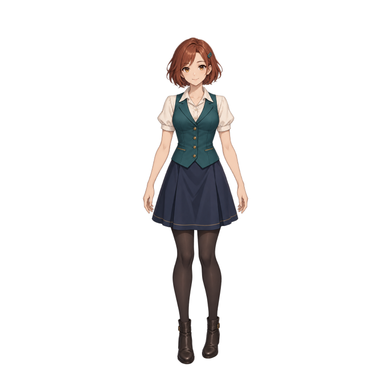
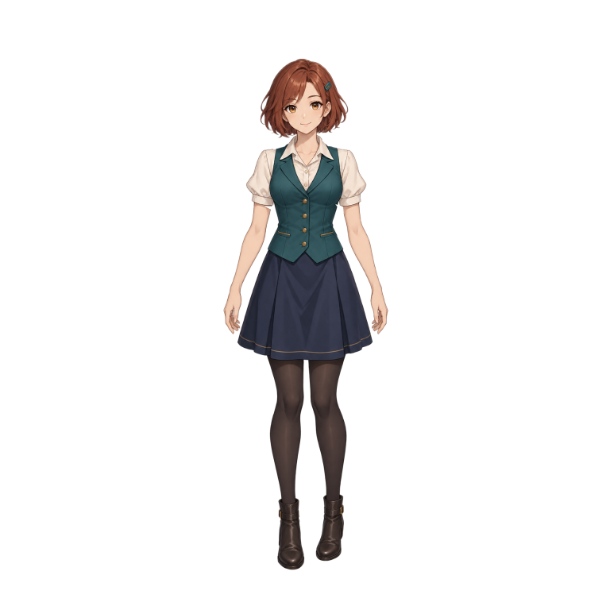

# MotionForge

| 原圖 | 揮手 | 思考 |
| :---: | :---: | :---: |
|  |  |  |

上面這三張就是用 **MotionForge 0.3.1** 做出來的：左邊是原本的角色圖，中間跟右邊是做出來的動畫。（[展示素材說明](examples/showcase/README.md) · [下載 0.3.1](https://github.com/kdazero/MotionForge/releases/tag/v0.3.1)）

---

## 一句話講完

**把角色圖丟給 AI，用聊天的方式叫它幫你做 2D 動畫。**

MotionForge 是一個裝在你自己電腦上的小工具。它本身不會「想」，負責想的是你的 AI（例如 Claude）；MotionForge 負責給 AI 一套「動畫工作台」：切圖、綁骨架、排動作、算圖、逐格檢查、匯出檔案，全部都有。AI 透過 [MCP](https://modelcontextprotocol.io/)（一種讓 AI 呼叫本機工具的標準）來用它。

你只要像跟美術同事講話一樣跟 AI 說：「幫我讓這個角色揮手，慢一點，手心要翻過來」，剩下的讓 AI 去操作。

## 你需要準備什麼

- **一台電腦**（Windows、macOS、Linux 都可以），裝好 **Python 3.12 以上**。
- **一個能接本機 MCP 的 AI 客戶端**，而且要能「看圖」（例如 Claude Desktop、Claude Code）。AI 的費用和資料怎麼處理，看你用的那家服務。

**不需要：** Spine、顯示卡、MotionForge 帳號。全部在 CPU 上跑，MotionForge 本身不連任何雲端服務。

## 它能做什麼

- **切圖**：從一張完整角色圖裡，把頭、身體、手臂等部件切成透明 PNG。
- **綁骨架**：建立父子骨架，手臂、手肘可以用網格（mesh）彎曲，不會一折就斷。
- **做動作**：待機、揮手、思考……可以調速度、換表情、換手型。
- **鎖住原圖**：原始素材、比例、鏡頭範圍都會被記錄，改壞了可以退回之前的版本。
- **匯出**：透明 WebP、APNG、PNG 序列、GIF、spritesheet 都可以。
- **逐格檢查**：AI 要真的一格一格看過、記錄下來，才能正式匯出；沒看完的一律標「草稿」。

## 先說清楚它「不能」做什麼

免得你期待落空：

- **沒有圖形介面。** 沒有視窗可以拖拉，全部透過 AI 對話來操作。
- **不會自己看影片抓動作。** 你可以給 AI 看參考影片，但「看懂影片」是 AI 客戶端的事，MotionForge 不收 MP4，也不做動作捕捉。
- **不會幫你畫圖。** 被遮住的地方（例如藏在身體後面的手臂）它沒辦法變出來，要你自己補畫，或用 AI 客戶端的生圖功能補。
- **動畫好不好看，還是要人看。** 工具的自動檢查只能抓技術問題（缺圖、破洞之類），自然不自然要你自己判斷。
- **GIF 只有「全透明／不透明」兩種。** 想要半透明的柔邊，請用 WebP、APNG 或 PNG。

## 5 分鐘裝好

### 1. 下載專案

到 GitHub 按 **Code → Download ZIP** 解壓縮，或用 git：

```bash
git clone https://github.com/kdazero/MotionForge.git
cd MotionForge
```

> 注意：請照下面的方式從原始碼安裝。**不要直接 `pip install motionforge`**，PyPI 上同名的套件不一定是這個專案。

### 2. 安裝

**Windows（PowerShell）：**

```powershell
py -3.13 -m venv .venv
.\.venv\Scripts\python.exe -m pip install .
```

如果你裝的是 Python 3.12，把第一行的 `3.13` 改成 `3.12`。不用「啟用」虛擬環境，也不用改 PowerShell 的執行原則，直接照打就好。

**macOS／Linux：**

```sh
python3 -m venv .venv
.venv/bin/python -m pip install .
```

### 3. 跑個範例，確認裝好了

**Windows：**

```powershell
.\.venv\Scripts\python.exe examples/run_demo.py --workspace ./workspace
```

**macOS／Linux：**

```sh
.venv/bin/python examples/run_demo.py --workspace ./workspace
```

這會用內附的幾何小機器人做一段揮手動畫，跑完會告訴你檔案在哪。這一步**不需要 AI 帳號**，純粹確認安裝沒問題。（小機器人只是很陽春的關節示範，不代表人體動作的品質。）

想看揮手、思考的完整版本，可以再跑 `examples/replay_gestures.py`（參數一樣是 `--workspace ./workspace`），會輸出兩段透明動畫。

## 接上你的 AI

### 1. 產生設定

```powershell
.\.venv\Scripts\python.exe scripts/mcp_config.py --workspace ./workspace
```

（macOS／Linux 把 `.\.venv\Scripts\python.exe` 換成 `.venv/bin/python`。）

它會印出一段 JSON，裡面已經幫你填好這台電腦上的絕對路徑，長得像這樣：

```json
{
  "mcpServers": {
    "motionforge": {
      "command": "D:\\你的路徑\\MotionForge\\.venv\\Scripts\\python.exe",
      "args": ["-m", "motionforge", "--workspace", "D:\\你的路徑\\MotionForge\\workspace"],
      "env": {"PYTHONUTF8": "1"}
    }
  }
}
```

### 2. 貼進 AI 客戶端的設定

把裡面 `motionforge` 那一段**加進**你 AI 客戶端的 MCP 設定，然後重新連線。

> **小心：是「加進去」，不是整個蓋掉。** 你原本如果有其他 MCP 工具，記得保留。

### 3. 跟 AI 打聲招呼

第一次可以直接這樣說：

> 使用 MotionForge。先讀 `get_capabilities` 和 `motionforge://workflow`，然後查看現有角色，找出範例機器人跟 wave 動作，看一下預覽跟我說結果。接著複製一個比較慢的揮手，輸出草稿 WebP 讓我比較。

> 提醒：這是「本機」工具，AI 客戶端必須能在你電腦上啟動程式。網頁版的雲端 AI 連不到你電腦的 localhost，所以接不上。

更詳細的步驟和常見問題：[安裝與連線](docs/INSTALL.md)。

## 用你自己的角色

大概流程是這樣：

1. **給角色圖。** 最好是已經拆好的透明 PNG（頭、身體、上臂、前臂、手、表情）。只有一張完整圖也行，AI 會幫你切，但被擋住的地方要另外補畫。檔案可以直接丟給 AI；自己手動放進 `workspace/inbox/` 資料夾的話，目前只認 PNG。
2. **給動作參考。** 影片、GIF、關鍵姿勢圖都可以。講清楚「第幾秒到第幾秒」、「要模仿哪個部位」。AI 看不到外部影片的話，就給檔案或附時間的截圖。
3. **讓 AI 先整理。** 它會先確認看得到參考，把動作拆成「起手、主要動作、收尾」，再問你有沒有缺手型或被遮住的部件。
4. **AI 動手做。** 建角色、排動作、算出草稿給你看。
5. **你來挑毛病。** 越具體越好，例如「0.8 秒那邊手腕翻太快」。改到滿意、逐格檢查完，就可以正式匯出。

相關文件：

- [使用教學](docs/USAGE.md)：完整操作流程
- [怎麼給動作參考](docs/REFERENCES.md)
- [需求表範本](examples/motion-request.md)：複製來填就好
- [工具清單、座標與限制](docs/TOOLS.md)

## 想直接用現成的揮手／思考？

專案裡內建了一組「動作配方」（`female_gestures_v1`），就是一個測試角色的定稿揮手（約 3.67 秒）跟思考（4.8 秒），連同 31 張分件、各種手型、網格和完整時間軌都打包好了。

跟 AI 說「用 `instantiate_motion_recipe` 建立 `female_gestures_v1`」，它就能直接在你電腦上重做出來，不需要原作者的電腦，也不需要 Spine。

要注意幾件事：

- 配方用的是**另一個測試角色**，跟最上面展示圖的角色不同。
- 想把這套動作套到**你自己的角色**上，不能直接照抄角度：你的角色要有自己的手型，關節也要重新對位。做法寫在 [動作配方](docs/GESTURE_RECIPES.md) 和 [關節、膚色與遮擋](docs/JOINT_ASSEMBLY.md)。

## 最近改了什麼

**0.3.2**：修 bug、補防呆，動畫結果不變：

- 角色鎖定（`lock_identity`）之後，任何會改到骨架、附件或原圖的操作都會直接擋下，不會再存出一個算不了圖的角色。真的要改，改完再鎖一次就好。
- 只差大小寫的圖層名稱（像 `Hand` 跟 `hand`）會被擋下，避免在 Windows 上互相蓋掉。
- 輸入格式錯誤時，會給你看得懂的錯誤訊息，不會丟程式內部錯誤。
- GIF 的透明色在比較嚴格的看圖軟體上也能正常顯示；下載大檔案也變快了。

**0.3.1**：「關節接得更好」：

- 換手的時候，會照手腕根部的位置和寬度對齊，膚色也會自動取樣校正。
- 手肘彎曲時，袖口的輪廓不會被吃掉。
- 切圖時如果把衣服切掉一塊，或混到隔壁部件的碎片，會被擋下來。
- 思考動作時，手指會正確地擋在臉前面。

完整紀錄見 [CHANGELOG](CHANGELOG.md)。

## 支援的平台

GitHub Actions 會在 **Windows、macOS、Linux × Python 3.12／3.13** 上跑完整測試和兩個範例，0.3.1 全部通過。作者實際使用的環境是 Windows + Python 3.13。詳見 [版本驗證](docs/VALIDATION.md)。

## 給開發者

```bash
python -m pip install -e ".[dev]"
python -m pytest -q
python -m ruff check src tests scripts examples
python -m ruff format --check src tests scripts examples
python -m build
python scripts/package_release.py
```

想貢獻程式碼請先看 [貢獻指南](CONTRIBUTING.md)；安全相關請看 [SECURITY](SECURITY.md)。

## 授權

- 程式碼、文件、內附的程式繪製機器人：[MIT](LICENSE)。
- 第三方套件各有各的授權，見 [第三方聲明](THIRD_PARTY_NOTICES.md)。
- **你自己放進來的角色和參考素材，不會因為用了這個工具就變成 MIT。** 版權還是你的（或原作者的）。

本專案不附帶 Spine 編輯器或官方 Spine Runtime。它只能讀取部分 Spine 3.8 格式的結構資料，不代表完整相容，也不是官方認證。

## 遇到問題？

到 [Issues](https://github.com/kdazero/MotionForge/issues) 開一則，附上：

- 作業系統、Python 版本、MotionForge 版本
- 你做了什麼（怎麼重現）
- 錯誤訊息（記得先把私人路徑、帳號之類的資料拿掉）
